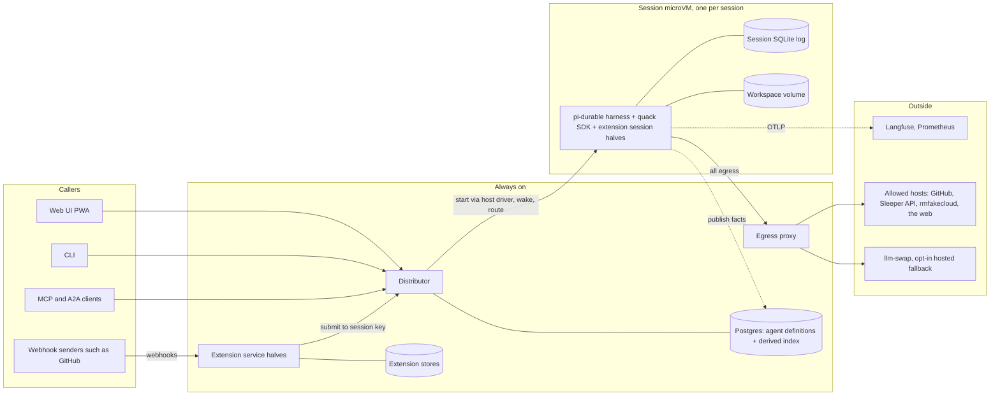
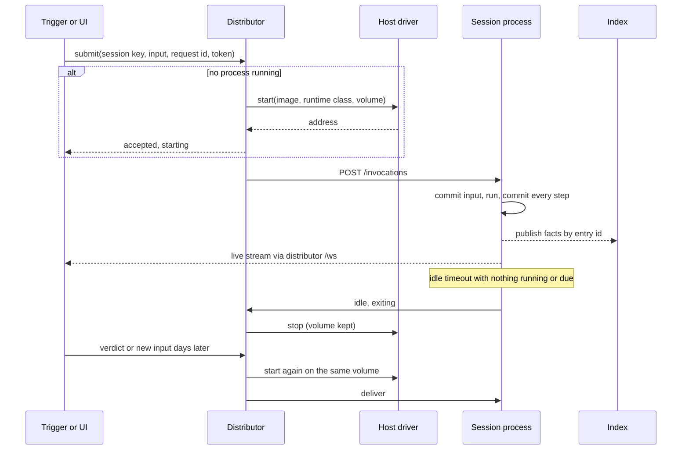
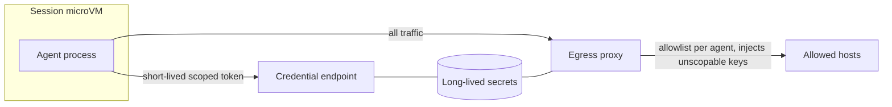

# RFC 0001: Quack v1 core architecture

- **Status:** Accepted, 2026-10-30
- **Decides:** the operator. Approval means the rewrite starts from this design once the UI mockups are also signed off.
- **Inputs:** [PRD](../prd.md), [SRS](../srs.md), [decisions](../decisions.md) (`A*` entries are this RFC's decisions), [layer diagram](../cloud-agent-layers.svg)
- **Extension RFCs:** [extensions/](extensions/)

## Summary

Quack v1 is a TypeScript system built on upstream pi-durable. Each session is its own process, inside its own microVM, holding its own SQLite log; that log is the only source of truth. A small always-on distributor authenticates callers, routes each request to the session that owns it, starts and wakes sessions through a host driver, and issues short-lived identities and credentials. A thin quack SDK adds the four concepts pi-durable lacks: gated actions, decision points, artifacts and approval chains. Everything else, including the judge, memory and every workload, is an extension with a session half loaded into the session process and an optional service half running as its own process. Sessions publish facts to a Postgres index that the UI's cross-session screens read, and the index can always be rebuilt from the logs.

## Motivation

The PRD names six root causes of v0's problems. Each maps to one structural choice here:

| Root cause | Structural answer |
| --- | --- |
| No core primitive; per-feature storage and UI | One durable log per session (pi-durable). Quack concepts are entries and documents in it; cross-session views are a derived index (A6). |
| The server is the unit of scale | The session is the unit: one process, one microVM, one volume, routed by session key (A1, A7, A11). |
| Quality bought with model calls | Evidence and limits are part of the agent definition; checks run once per sealed artifact version; code mode and subagent questions replace whole-agent fan-out (D32, D36, D37). |
| Many extension mechanisms, no contract | One extension shape (session half plus optional service half) on one versioned SDK (A2, A4). |
| UI mirrors internals | The UI reads pi-durable's own stream and the index, and is designed around four jobs, not backend nouns (A9, D30). |
| Features without value measures | Agents are promoted only through benchmarks; memory must win its own (D50, MEM2). |

## Guide-level explanation: one pull request review

A concrete trace through the system, from label to posted review.

1. The operator adds the review label to PR #42. GitHub sends a webhook to the **GitHub service half**, a small long-running process. It verifies the signature and submits `review` to session key `github:owner/repo#42` through the distributor, carrying its workload token and the delivery id as the request id (so a redelivery is not a second review).
2. The **distributor** finds no running process for that key. It looks up the promoted agent bound to the trigger (the reviewer fixture shipped by the GitHub extension, at its current definition version), asks the **host driver** to start a microVM from the agent's runtime image with the session's volume attached, and forwards the submission. The UI already shows the session as "starting" within a second (NFR-PERF-3).
3. Inside the microVM, the **session process** opens its SQLite log with pi-durable, installs the extensions the definition selects, and runs the input with the reviewer role. A lifecycle hook from the GitHub extension clones the repo through the egress proxy, using a repo-scoped token from the session's credential endpoint, and builds the evidence: conventions and the blast radius of each changed symbol (G2).
4. The agent reviews, using shell and code mode freely (G3), and writes `artifacts/review.md`, a declared artifact of kind `github.review`. An after-tool hook validates each write against the kind's schema.
5. The run yields. The **judge extension's** yield hook seals the artifact as version 1 (a snapshot in the log), checks it against the reviewer rubric pinned in the definition, and finds one failed criterion. It continues the run with that feedback. The agent revises; version 2 is sealed and passes.
6. The agent calls `github_post_review` with a reference to version 2. That tool is a **gated action**, and the definition's approval chain for it is the judge verdict already attached to that version, so it proceeds. The posted text is byte-for-byte the checked version (ART-4). Had the chain ended at a human, the call would wait durably, the approval would appear in the operator's inbox, and the session process could idle out and be woken by the verdict.
7. Every fact (artifact sealed, verdict, action executed, cost) is published from the log to the **index**. The operator's session list, the artifact list and the audit trail read from there; the live session view read pi-durable's own event stream throughout.
8. With no input for the idle timeout, the session process exits and the microVM is released. The volume stays. Two days later a `/review` comment on the PR wakes the same session with its history and workspace, in the reviewer role again; a `/fix` would run as implementer (D33).

## Reference-level explanation

### Components

| Component | Owns | Holds no |
| --- | --- | --- |
| Distributor | OIDC sign-in, workload tokens (A12), session-key routing, session start/wake/stop via the host driver, the credential endpoint behind each session, agent definitions API, index queries | Domain logic, session state |
| Session process | One session's pi-durable harness, its log, its workspace, the extensions its definition selects | Other sessions' state, long-lived secrets |
| Service half | One extension's always-on work: ingress, schedules, its own store | Access to sessions except by submitting |
| Egress proxy | Per-agent hostname allowlists, injection of unscopable API keys | Anything a session can read back |
| Postgres | Authoritative agent definitions (A8); the derived index (A6) | Session truth |

### The session runtime and the container contract

A session image contains Node, pi-durable, the quack SDK, the extension packages of its toolchain profile and those toolchains (A8). It serves the container contract (RUN-3): `GET /ping`, `POST /invocations`, `/ws`. The distributor speaks only this contract to sessions, which is why another host (ECS, AgentCore) can replace both the host driver and, in the cloud, the distributor's routing (NFR-PORT-1).

At start the process reads its agent definition version (passed by the distributor), opens `session.sqlite` on the volume, installs the selected extensions into pi-durable's registry, and calls `resume()` so unfinished work continues (HAR-3). It exits after the agent's idle timeout once nothing is running or due, which releases the microVM (NFR-PORT-3).

### The quack SDK on pi-durable

The SDK is a set of pi-durable extensions plus re-exported pi-durable APIs. Extensions import only the SDK, so an upstream break is absorbed in one package (A4).

| Quack concept | Built on | Behaviour |
| --- | --- | --- |
| Agent role per run | `configure()` at run start | The input names a role; the SDK applies that role's prompt, tools and extension selection before the run starts and never mid-run (D33). |
| Gated action | `beforeTool` hook plus a durable task | If the definition gives the tool an approval chain, the hook commits a pending-approval document and blocks the call on a waiting task. A verdict arrives as a submission; approve runs the call, reject returns the reason to the model as an error result (GATE-6, GATE-8). No chain: the call proceeds and an audit entry is written (D41). An extension may mark an action as always gated (memory does, D7). |
| Decision point | A durable task running the resolver chain | Each resolver answers or escalates (D16). The default resolver forks the conversation at the current entry, asks with an answer schema, records the answer, and discards the fork (D18). Other resolvers: a named model such as Clef, an extension, a human via the inbox. |
| Approval chain | Decision points | An approval is a decision point whose options are approve and reject and whose evidence includes the full action and the artifact version; checkers raise their own decision points inside it (D15). |
| Artifact | Declared workspace paths, an `afterTool` hook, a `quack.artifact` document | Writes to declared paths are validated against the kind's schema. Sealing commits an immutable snapshot with a content hash and version; verdicts attach to that version; gated actions take a version reference (ART-1 to ART-5). |
| Checker | `onYield` hook | When a run yields, the checker seals declared artifacts, checks them, and either accepts or continues the run with feedback, up to the definition's revision limit (J1). |
| Subagent question | pi-durable task-owned child conversation | A foreground tool with its own optional model; the answer returns as a tool result (D37). |
| Sessions starting sessions | A tool that submits through the distributor | The parent holds the child's session key; the child's results return as follow-up input (D34). |
| Code mode | pi-durable's code mode extension | On by default; every nested call runs the same hooks and gates (D36). |
| Fact publishing | A commit listener in the session process | Selected entries (seals, verdicts, approvals, cost, status, audit) are sent to the index keyed by entry id and retried until acknowledged, so publishing is lossless and idempotent (A6). |

### Session lifecycle

Crash recovery: the host driver restarts a crashed session process within 60 s on the same host (NFR-HAR-2); pi-durable's `resume()` continues from the last commit and parks work that keeps crashing (HAR-10). Moving a session to another host is stopping it, moving its volume, and starting it there.

### State

Per session: `session.sqlite` (the pi-durable log, tasks and documents, including sealed artifacts) and the workspace, both on the session volume. Retention and deletion act on the volume (D24, NFR-SEC-5). Central: Postgres holds agent definitions (authoritative) and the index (derived, rebuildable with a replay command). Service halves keep their own stores (A6).

### Agents and images

CI builds a few runtime images, one per toolchain profile (slim for research, Sleeper and reMarkable; dev for GitHub), each with a pinned set of extension packages. An agent is a versioned definition in Postgres naming its runtime image version, model, roles and prompts, selected extensions, skill and rubric versions, approval chains, egress allowlist, runtime class, limits and retention (A8). Definitions come from extension fixtures, files, or the UI; every edit is a new immutable version; a session keeps the version it started on. Draft agents run on demand; only promoted agents, which passed their benchmark, bind to unattended triggers (D48 to D50).

### Isolation, egress and credentials

Sessions run as Kata microVMs by default, or under gVisor where a definition chooses it (A7). The only route out is the egress proxy. Long-lived secrets stay with the distributor and proxy; a session receives only short-lived scoped tokens, held in memory.

### Surfaces

- **Web UI.** React, Vite and Tailwind v4 following the design-frontend skill. Live session views consume pi-durable's event stream through the distributor's `/ws` (A9); cross-session screens read the index over HTTP. Extension pages and artifact renderers are compiled into the app (A10).
- **CLI.** Operations and scripting over the distributor's HTTP API, with JSON output (D23).
- **MCP and A2A.** The distributor exposes promoted and draft agents as MCP tools and A2A agents: start work, follow it, receive the sealed artifact (D44).
- **Webhooks.** Always land on a service half, never on the distributor (A2).

### Models and telemetry

Providers come from pi-ai; llm-swap is an OpenAI-compatible provider, and a hosted fallback is an opt-in per definition (A14, D12). Cloud-equivalent prices come from a table mapping each local model to a reference hosted price (D29). Sessions export pi-durable's OpenTelemetry schema plus quack spans for decisions, approvals and seals directly to Langfuse and Prometheus (A13).

### Failure behaviour

| Failure | Effect | Recovery |
| --- | --- | --- |
| Session process crashes | That session stops | Restarted within 60 s; resumes from its last commit; parked after repeated crashes |
| Distributor down | No new routing or sign-in; running sessions keep working | Service halves retry submissions with their request ids; UI reconnects and the stream sends a fresh snapshot |
| Postgres down | Inbox, lists and new agent edits unavailable | Sessions keep running and queue their facts; the index catches up from the outbox |
| llm-swap down | Model calls fail | Retried with backoff; queued input waits (MOD-3); opt-in fallback where configured |
| Egress proxy down | All egress fails closed | Calls fail as tool errors; no traffic bypasses the proxy |

## Drawbacks

- **Upstream risk.** pi-durable is experimental and may change its API without notice. Pinning per runtime image, the SDK layer and benchmarked bumps contain it, but the core of quack depends on a project it does not control.
- **More moving parts than v0.** A distributor, an egress proxy, service-half processes, Postgres and one microVM per session replace one server process. Each is simple, but there are more of them to deploy and watch.
- **Cold starts.** Booting a microVM and cloning a repository happen per session start. Progress is streamed, but setup counts against each workload's SLO.
- **Extension UI needs a UI deploy** (A10).
- **Leaving Go.** v0's Go code, tooling and the operator's Go fluency do not carry over.

## Rationale and alternatives

- **Go on PiG's port of pi-durable.** Rejected: two sources of churn (upstream plus the port), lagging documentation, one maintainer (A4).
- **Go distributor with a TypeScript harness.** Viable because the seam is HTTP, and still possible later, but a second toolchain for the smallest component and schemas duplicated across languages.
- **Own harness.** Rejected: rebuilding a large, subtle runtime that pi-durable already provides.
- **One shared Postgres for all session state.** Rejected: pi-durable assumes one owner per store and has no Postgres adapter; shared state is how v0 grew per-feature tables (A6).
- **Plain or hardened containers.** Rejected as the default: they share the host kernel (NFR-SEC-1). gVisor remains available per agent (A7).
- **Kubernetes or Nomad at home.** Rejected for v1: the host-driver interface keeps distribution possible without running an orchestrator (A11).
- **ACP-driven external coding agents.** Dropped: the harness is the coding agent (A5).

## Prior art

- `@earendil-works/pi-durable`: the durable log, tasks, hooks, inbox, live views, compaction and code mode this design builds on.
- Amazon Bedrock AgentCore: per-session microVM runtimes behind a dispatcher and a container contract; this design keeps that contract so AgentCore can host quack sessions later.
- Cloudflare Durable Objects: one addressable owner per piece of state, woken on demand; pi-durable ships a Durable Object storage adapter on the same model.
- Quack v0: the trust gate, the judge, Langfuse experiments and service-half lessons (webhook intake, the Sleeper page).

## Unresolved questions

- **Distributor availability.** At home the distributor is a single process; is a restart-on-failure supervisor enough for v1? (Proposed: yes.)
- **Postgres backups and definition history.** Agent definitions are authoritative in Postgres, so it needs backups that the derived index does not. Where do they go?
- **Runtime image cadence.** How often runtime images are rebuilt to pick up toolchain and security updates, and how that interacts with benchmarks.
- **gVisor versus Kata cost.** To be measured on the GitHub agent's builds before choosing its runtime class.
