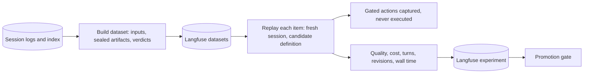

# Eval extension architecture

- **Status:** Accepted, 2026-10-30
- **Requirements:** [eval](../../extensions/eval.md) · **Core:** [RFC 0001](../0001-core.md)

## Summary

Eval turns recorded sessions into Langfuse datasets. It replays them against a candidate agent definition in sandboxed sessions that can't deliver anything, and reports the results as Langfuse experiments. Core's promotion gate reads those results.

## Design

- **Datasets.** Each item holds a session's inputs plus its sealed artifacts and verdicts as expected outputs. That's at least 20 real cases per agent, including known-bad ones (EV2). Items are built from session logs and the index, and stored in Langfuse (EV1).
- **Replay.**
  - Each item runs in a fresh session on the candidate definition version (model, prompts, rubrics, extensions, runtime image).
  - **Every gated action in a replay session is captured and rejected as "eval: not delivered"**, so a benchmark can never post a review, push a commit or upload a document.
  - Repeats run only for close comparisons.
  - Experiments may use hosted models (EVL-4).
- **Results.** Results go to Langfuse as experiments: checker verdicts, cost at cloud-equivalent rates, turns, revisions and wall time. The promotion gate (DEP-6, OBS-5) compares the candidate against the current version.

## Unresolved questions

- **Replaying the outside world.** Tool results that depend on it (web pages, a PR's current head) differ between the recording and the replay. Proposed: re-fetch live by default, and allow a dataset item to pin recorded tool results when a comparison needs identical inputs.
