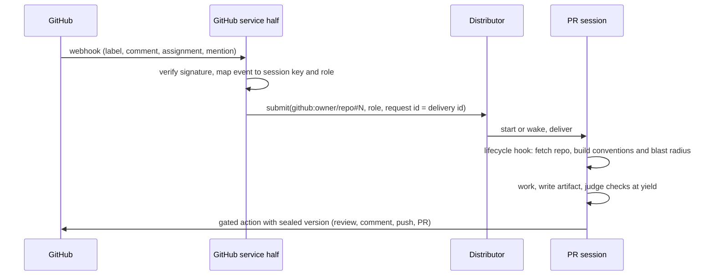

# GitHub extension architecture

- **Status:** Accepted, 2026-10-30
- **Requirements:** [github](../../extensions/github.md) · **Core:** [RFC 0001](../0001-core.md)

## Summary

A service half receives the GitHub App's webhooks and turns them into submissions. A session half gives the reviewer, implementer and responder roles their evidence, their gated GitHub actions and their artifact kinds. Each PR or issue is one session on the dev runtime image.

## Design

### Service half

Verifies webhook signatures and stores the App's installations.

Maps events to session keys and roles (G5):

| Event | Session key | Role |
| --- | --- | --- |
| Review label added | `github:owner/repo#N` | reviewer |
| `/review` comment | `github:owner/repo#N` | reviewer |
| `/fix` comment | `github:owner/repo#N` | implementer |
| Issue assigned to the App | `github:owner/repo#N` | implementer |
| App mentioned in a comment | `github:owner/repo#N` | responder |

The delivery id is the request id, so redeliveries never duplicate work (HAR-5).

### Session half

**Fixture agents:** `reviewer`, `implementer`, `responder`. They run on the dev image with toolchains and language servers, in a Kata microVM by default.

**Lifecycle hook (session created or resumed):**
1. Fetches the repository with a repo-scoped installation token from the credential endpoint.
2. Collects conventions (AGENTS.md or CLAUDE.md, lint configuration, the linked issue).
3. Computes the blast radius of changed symbols with the language servers.
4. Writes everything to a `github.evidence` document that the role prompt renders (G2).

**Tools:** read-only GitHub queries (PR, checks, threads) and the coding tools with unrestricted shell (G3). These tools are gated actions:
- `github_post_review`
- `github_comment`
- `github_open_pr`
- `git push`

Each one takes a sealed artifact version where it publishes text.

**Artifact kinds:**
- `github.review`: summary, findings with path and line, verdict.
- `github.reply`
- `github.pr_body`

**Checker:** the judge, with an audited rubric per kind (D11).

**Egress:** GitHub, the toolchains' package registries, and model endpoints.

## Unresolved questions

- **Issue to PR continuity.** When implement-from-issue opens PR #M, should `github:owner/repo#M` alias to the issue's session, so a later `/review` on the PR continues the same unit of work (D19)? Proposed: yes, by registering a session-key alias with the distributor.
- **Blast radius.** Its exact computation (language servers versus static indexers) is an implementation choice, measured against the 10-minute SLO.
