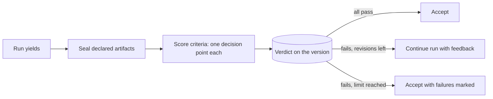

# Judge extension architecture

- **Status:** Accepted, 2026-10-30
- **Requirements:** [judge](../../extensions/judge.md) · **Core:** [RFC 0001](../0001-core.md)

## Summary

The judge is a checker. It hooks the run's yield, seals the declared artifacts, scores each sealed version against the rubric its agent definition pins, and either accepts it or continues the run with feedback. The same scoring serves as a resolver in approval chains.

## Design

- **Rubrics** are knowledge pinned in the agent definition (D27, A8). Each is audited before it's ported from v0 (D11).
- **Criteria** are decision points (D15). Each one can therefore be routed to a different resolver, such as a deterministic check, the default model, or a stronger or dedicated model. Criteria are scored once per sealed version.
- **Verdicts** attach to the artifact version (ART-3): criteria results, evidence and feedback. A version delivered after the revision limit carries its failed criteria, and the UI marks them inline (R3).
- **The revision limit** comes from the agent definition (J1).
- **Measurement.** Verdicts and their inputs are recorded in the log and traced, so the eval extension can replay the judge and measure agreement, false passes and false fails, and saturated criteria (D45).

## Unresolved questions

None beyond the core RFC.
