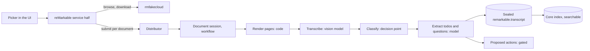

# reMarkable extension architecture

- **Status:** Accepted, 2026-10-30
- **Requirements:** [remarkable](../../extensions/remarkable.md) · **Core:** [RFC 0001](../0001-core.md)

## Summary

The service half browses rmfakecloud and starts ingest for the documents the operator picks. Each document is ingested by a workflow in its own session, which produces a searchable `remarkable.transcript` artifact and proposes the actions it finds. The session half also provides `remarkable_upload` for other agents, such as research, to send documents to the tablet.

## Design

### Service half

- Logs in to rmfakecloud and serves the document picker's data.
- Submits one ingest per selected document to `remarkable:<document id>`, with the document version as the request id.
- Tracks each batch so one push announces that the whole batch is done (RM4).

### Session half

- **Workflow `remarkable.ingest` (D35):**
  1. Render pages to images (code).
  2. Transcribe with a vision-capable model named in the definition.
  3. Classify topic and type (decision point).
  4. Extract actions (model).
  5. File the document (code).
- **Artifact kind `remarkable.transcript`:** text, classification and source pages. It's searchable through the index, so research can cite it (A15).
- **Extracted actions** become gated actions, such as starting a research session (D34). Their approval chain ends at the operator.
- **Tool `remarkable_upload`:** a gated action that uploads a sealed artifact version to the tablet as PDF. Other agents (research) select it.
- **Credentials.** rmfakecloud has no long-lived API token, so the credential endpoint performs the login and hands the session a short-lived token.
- **Egress:** rmfakecloud and model endpoints.

## Unresolved questions

None beyond the core RFC.
