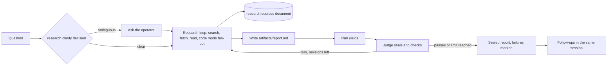

# Research extension architecture

- **Status:** Accepted, 2026-10-30
- **Requirements:** [research](../../extensions/research.md) · **Core:** [RFC 0001](../0001-core.md)

## Summary

Research is a session-only extension: one session per question, in the researcher role, on the slim runtime image. It adds source tools, a provenance document that records everything fetched, the `research.report` artifact kind, and a clarifying decision point. The judge checks reports; past reports and reMarkable transcripts come from core's artifact index (A15), so research has no service half.

## Design

**Session half.**

- **Fixture agent:** `researcher`. It uses the slim image, the judge, and code mode on.
- **Tools:**
  - `web_search`
  - `web_fetch` (pages and PDFs to text)
  - `paper_search` (arXiv, Semantic Scholar)
  - `artifact_search`, over core's index, restricted to `research.report` and `remarkable.transcript`
  - The coding tools for cloning and reading repositories
- **Provenance.** Every fetch appends to a `research.sources` document: id, URL, fetched-at, source date when known, content hash. Citations in the report reference source ids, so "every citation was fetched in this session" is checkable from the log.
- **Artifact kind `research.report`.** Markdown with source-id citations, an assumptions section, and check marks rendered by the UI. Each new report version is a new sealed version (R4).
- **Decision point `research.clarify`.** Runs before the first research turn (R1). It defaults to the session's own model.
- **Gated actions.** None of its own. Send-to-reMarkable uses the reMarkable extension's `remarkable_upload` tool, which the researcher definition selects.

**Egress.**
- The search and paper API hosts are allowlisted. Their keys are injected by the proxy.
- Model endpoints are allowlisted.
- `web_fetch` needs arbitrary public hosts (see below).

## Unresolved questions

- **Broad fetch versus deny-by-default egress.** Research must read arbitrary public pages, while D25 demands a reviewed allowlist. Proposed: a public-web class in the proxy that allows GET to any public host, blocks private and link-local ranges, and is granted per agent like any allowlist entry.
- **Which search and paper providers to use.**
