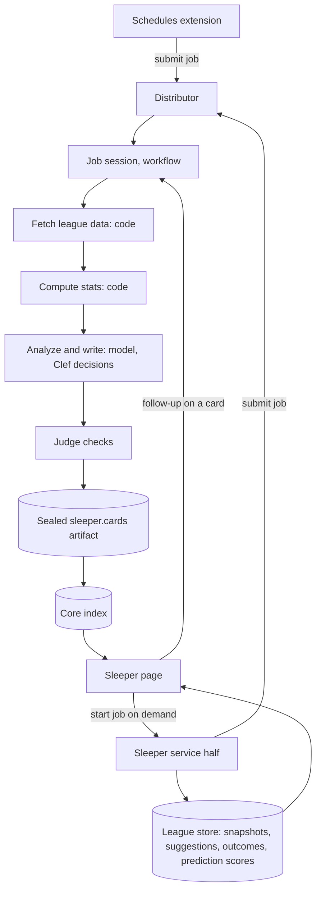

# Sleeper extension architecture

- **Status:** Accepted, 2026-10-30
- **Requirements:** [sleeper](../../extensions/sleeper.md) · **Core:** [RFC 0001](../0001-core.md)

## Summary

The service half owns league data and the Sleeper page's data. Each weekly job is a workflow run in its own session; its result is a sealed `sleeper.cards` artifact that the page shows. Sleeper has no gated actions because it never writes to Sleeper.

## Design

### Service half

- Takes daily league snapshots from the read-only Sleeper API.
- Keeps the league store indefinitely (S4): snapshots, every suggestion with its outcome, and prediction scores.
- Registers each job's schedule with the schedules extension, with a deadline-based usefulness window (S5, SC1).
- Starts on-demand jobs from the page.
- After games, scores past suggestions and predictions against outcomes. This scoring decides when predictions leave observe-only (SL-6).

### Session half

- **Workflows (D35):** one per job (lineup, waivers, trade finder, trade analysis, trade talk, league report, league history, player trends, predictions). Each runs fetch and compute steps in code and calls a model only for analysis and writing. Close calls are raised as decision points that a definition can route to Clef.
- **Session keys:**
  - `sleeper:<league>:<week>:<job>` for weekly jobs, so reruns within a week continue the same session.
  - Trade talks key on the trade.
- **Artifact kind `sleeper.cards`:** a typed card set per job, rendered by the page's components (A10).
- **Follow-ups:** asking about a card continues the job's session with the card in context (S2).
- **Checker:** the judge, with audited Sleeper rubrics.
- **Egress:** the Sleeper API and model endpoints.

## Unresolved questions

None beyond the core RFC.
